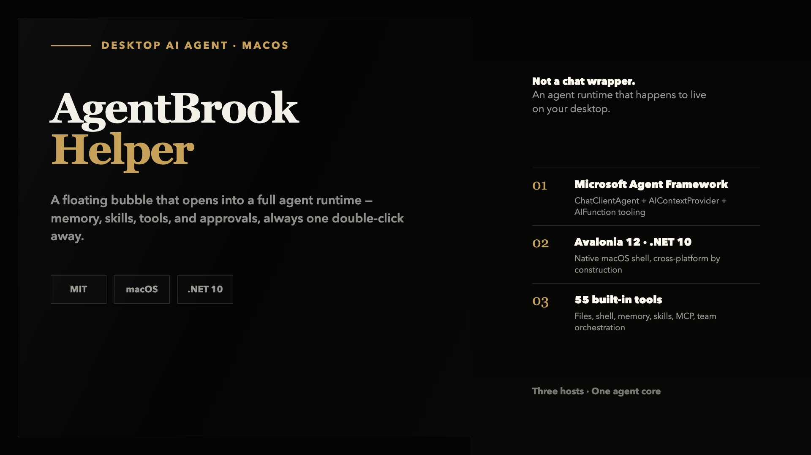
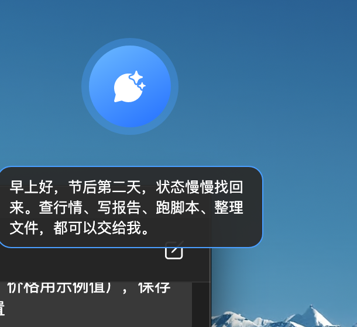
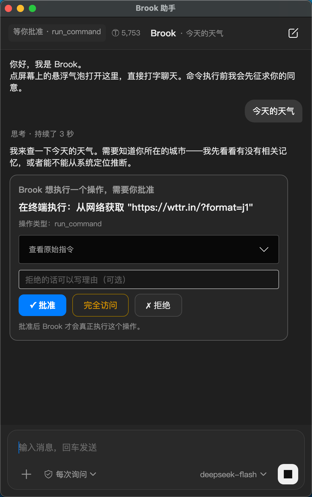
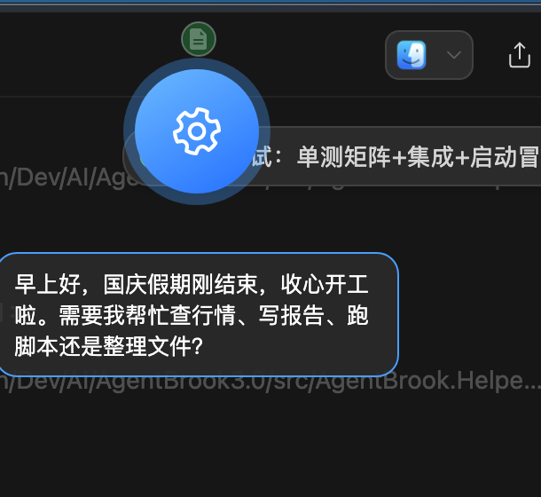
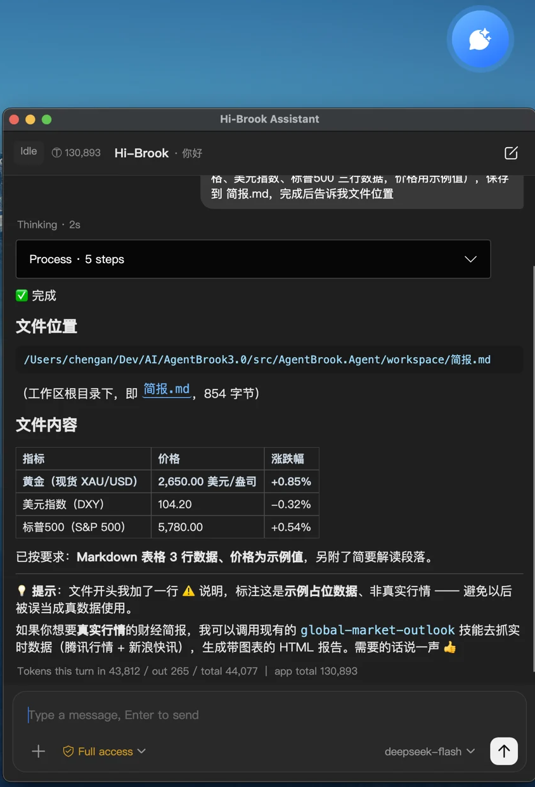
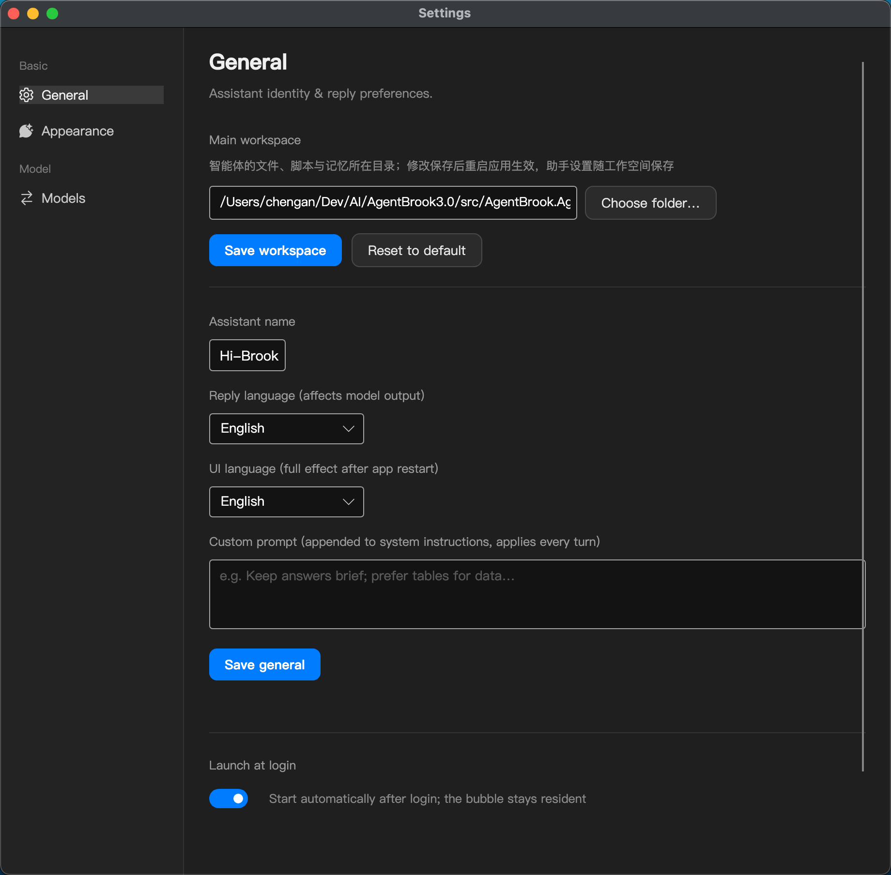
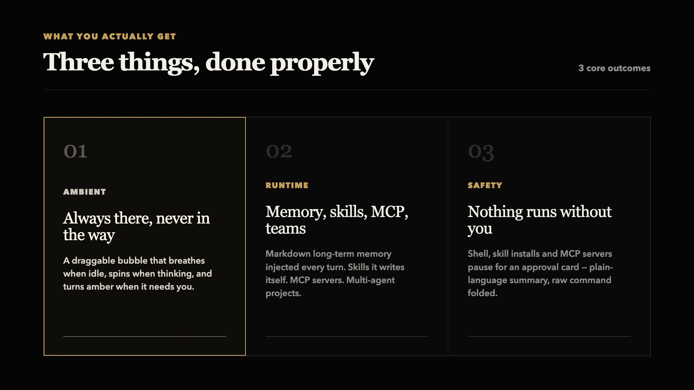

<div align="center">

# AgentBrook Helper

**A cross-platform desktop AI agent — a floating bubble that opens into a full agent runtime. One machine is a node; many machines are a team.**



[](./LICENSE)
[](https://dotnet.microsoft.com/download)
[]()

English · [简体中文](./README.zh-CN.md)

</div>

---

## What this is

AgentBrook Helper is a desktop client for an AI agent that actually runs on your machine. A small draggable bubble sits in the corner of your screen; double-click it and a chat window opens. Behind that window is a complete agent runtime — long-term memory, a skill system it can extend itself, MCP servers, file and shell tools, human-in-the-loop approval, and multi-agent teamwork.

It is also a network node: over the standard **A2A protocol**, Helpers on your LAN can discover each other, pair up, form group chats and hand tasks around — each Helper still belongs to its owner alone, yet can team up when a job calls for it.

It is built on **.NET 10** and **Microsoft Agent Framework (MAF)**, and talks to any OpenAI-compatible endpoint (DeepSeek, OpenAI, Kimi, Zhipu GLM, OpenRouter, …).

It is not a chat wrapper around an API. The desktop shell is a thin layer — roughly 300 lines of glue — over a host-agnostic agent core that the console client shares.

## Screenshots

| Resident bubble · Startup greeting | Approve before it runs |
|---|---|
|  |  |
| **While working: spinning gear + tool orbit** | **Full conversation: Markdown table replies** |
|  |  |

**Settings**: main workspace / assistant identity / notification sound / launch at login / interface language (简体中文 · English · Bahasa Indonesia — the model's reply language can be set independently), all in one place.




## Why it exists

Agent runtimes are genuinely capable, but they live in terminals. A terminal is a tool you *go to*; a desktop assistant is one that is *already there*.

The gap isn't model quality — it's proximity. So this project takes an agent core and gives it a place to live: always visible, never in the way, and asking your permission before it does anything that matters.

## What you get



### An ambient bubble

A draggable, always-on-top bubble that does not steal focus. It breathes when idle, spins while thinking, and turns amber when it needs you — opening the chat window by itself. Closing the window hides it; the bubble stays. Paste screenshots straight into the input with Ctrl/⌘+V. Drag it against the left, right, or top screen edge and it docks half-hidden (macOS); hover and it slides fully out. Near the bottom edge it pops back fully into view.

### A full runtime behind it

The bubble opens onto an agent that remembers. Markdown memory files under `workspace/memory/` are injected into context on every turn, and the model can write to them. Skills load progressively from `SKILL.md` files — and the agent can author new skills from workflows it has actually verified. MCP servers are wired in over stdio. Projects let it split a goal across worker agents with their own workspaces and a message bus.

On the model side, any OpenAI-compatible endpoint plugs straight in, and multi-provider, multi-key configurations hot-swap at runtime; a protocol-family mechanism (openai / anthropic / zhipu / minimax / compshare / custom) makes non-OpenAI dialects nearly zero-adaptation.

### Generate images, video, and audio in chat

A 🎬 Multimedia dropdown sits next to the model selector, listing the image and video models your providers expose — type metadata comes from the fetched model list, and the media choice never mixes with the chat model. Pick one and just ask: the agent composes the prompt plus the model's required parameters and calls `media_generate` — images come back from a synchronous endpoint right away, while video and other long jobs are submitted as async tasks and polled for up to five minutes (anything still running hands back a task id the agent can check later without resubmitting); the result renders right in the bubble, images inline and video/audio as playable cards. Delegated sub-agents can generate media too, and switching to a media model other than the selected one asks for your approval first.

### Nothing runs without you

Shell commands, skill installation, MCP server registration and worker spawning all pause for an approval card. The card leads with a plain-language summary of what is about to happen; the raw command sits folded underneath. You can approve, reject with a reason — which goes back to the model so it can replan — or grant full access for the session, which resets on restart. High-risk actions in remote collaboration turns come back to your machine for approval too, and quitting or shutting down mid-turn is intercepted and announced, so a running turn is never cut in half.

### Interrupt, queue, and switch sessions anytime

While a turn is running, the send button turns into a stop button (Esc works too) and whatever completed is kept; anything you type while busy is queued and sent automatically when the turn ends. Sessions are managed from the top-bar switcher: titles are generated from the first message, "new session" archives the old one instead of wiping it, and switching replays recent history — scroll to the top to keep loading older messages back to the session archive's start — with context and rolling summary intact. Any session can be distilled into a `session-` skill with one click — other sessions can `load_skill` those conclusions and outputs, and the skill survives session deletion.

### On-demand context loading

The fixed token cost is deliberately kept low: MCP tool JSON Schemas are not loaded wholesale — the master index lists one line per tool, and the model calls them via `mcp_call` / inspects them via `mcp_tool_help` on demand. Heavy subtasks (research, long reports, bulk filing) can be delegated to a sub-agent with its own isolated context via `delegate_task`; only the conclusion returns to the main conversation. Sub-agents and session summarization run on the lightest model in your model list (tiered routing, configurable in appsettings). When history exceeds budget, older turns are condensed into a rolling summary injected at the head — long sessions and restarts stay lean.

### An A2A network: many machines, one team

Every Helper is also a network node. **Discovery**: LAN nodes find each other via UDP multicast, with node identity derived from an Ed25519 key — an IP change never turns a neighbor into a "new node". **Pairing**: both sides confirm, then verify a 6-digit code shown identically on both screens, guarding against spoofing and man-in-the-middle. Once paired, Helpers sync presence — online state, busy or idle, work state, even mood. **Peer sessions**: private one-to-one conversations with automatic offline retry, and delivery states you can see (written / delivered / processed).

**Group sessions** are the main event. Creating a group is one click — join is automatic and the group name is generated for you. Type `@` in the send box to pick a member for a directed answer, `@all` for the whole room — every Helper answers from the shared group context. Six anti-loop gates (consecutive auto-reply cap, ping-pong detection, rate quota, busy yielding, cooldown, idempotency) keep discussions from running forever; long threads are compressed every 10 rounds into a structured summary (conclusions, artifacts, process — minus the small talk) that is synced to the whole room, keeping token cost bounded. Offline members catch up automatically when they return; the group owner can rename, close, or remove members inline; a dedicated Summary tab shows the shared summary anytime. Helpers inside a group carry the same tool surface as the main conversation — high-risk actions still require local approval.

The network does more than chat. **File transfers** are chunked, SHA-256 verified and resumable, landing in a quarantine area before use. **Distributed tasks** go out as signed task manifests; a participant only accepts after its local owner approves, executes in an isolated context with its own budget, and delivers artifacts whose hashes are checked on arrival. Completed tasks earn immutable, signed review credentials (cooperation / efficiency / quality) that surface publicly only as aggregate scores — trust you can compute and verify. Everything runs on the **standard A2A protocol**: extensions are namespaced, unknown extensions must be ignored, and an ordinary A2A client can talk to your Helper too.

A built-in business scenario shows the pattern: Helpers acting for different departments file daily sales reports with signed, idempotent, de-duplicated submissions, aggregated by a coordinator.

Paired Helpers that are online on your LAN also show up as small avatar bubbles tucked under the main bubble — up to three, then a +N badge. Hover to fan them out into rings, hover an avatar for its name and state (online, away, busy, waiting for user…), and click one to jump straight to your session with that Helper.

### Token cards: 24-hour trial, pay-as-you-go top-ups

First-launch onboarding automatically requests a trial card from the billing service — ¥5 of quota, valid for 24 hours, bound to your device and network — and fills the model config for you (provider "AgentBrook", endpoint `https://api.agentbrook.com`). The model settings page shows a "Top up Token card" shortcut for the AgentBrook provider (your card Key is the API Key; top-ups take effect automatically), plus a "Fetch models" action that pulls the live model list and specs from the relay. The deliver page even offers a one-click "auto-fill into Helper" — the Helper's local loopback service writes the Key into the model config and opens the settings window for you. The single-instance settings window also gained a one-click Update button that re-fetches the model list, refreshes your balance, and runs the connectivity test in one go. On every startup the Helper additionally refreshes each configured provider's model list silently in the background and notifies you when models were added or retired.

### Automatic self-update

On the first launch of each day the Helper checks for a new version (once per day). When one is found, the bubble announces it (version + release notes); clicking "Update now" jumps to Settings, locates the version section, and runs the download-and-apply flow by itself. Both the daily check and auto-download can be turned off in Settings.

## How it works

Two hosts share one core. `AgentBrook.Agent.Core` exposes `BrookAgent.RunAsync`, which yields a stream of events — status changes, text deltas, tool started/completed, token usage, turn completion. Hosts consume that stream and render it however they like.

Anything requiring a human is routed through the `IBrookInteraction` interface: approval requests and `ask_user` both suspend the core and wait on the host. The console client prints a prompt; the desktop client shows a card. That single abstraction is what keeps two very different UIs from forking the agent.

| Piece | Role |
|---|---|
| `AgentBrook.Agent.Core` | Agent, tools, memory, skills, MCP, team orchestration |
| `AgentBrook.Agent` | Console host (REPL) |
| `AgentBrook.Helper` | Desktop host (Avalonia) — packaged on macOS, runs as-is on Windows |
| `AgentBrook.A2A.Core` | A2A protocol core: Peer/Group sessions, event ledger, node identity |
| `AgentBrook.A2A.Transport` | A2A transport: signed auth, pairing, discovery, message & group sync |

## Quick start

Requires the [.NET 10 SDK](https://dotnet.microsoft.com/download). Built and tested on macOS; the desktop client also runs on Windows.

```bash
git clone https://github.com/ChenGan666/AgentBrook-Helper.git
cd AgentBrook-Helper
```

**1. Configure a model provider.** Either open **Settings → Model** after launch (recommended), or put a key in `src/AgentBrook.Helper/appsettings.json`. The committed file is redacted; on first run it derives a default provider.

**2. Build and launch.**

```bash
cd src
dotnet build AgentBrook.slnx
```

**macOS** — package and sign a `.app`:

```bash
cd AgentBrook.Helper
./build-mac-app.sh        # publishes, signs and packages per-platform .app + zip
open ../publish/updated/osx-arm64/AgentBrook.Helper-*.app
```

**Windows** — run the desktop client directly (no packaging script involved):

```bat
cd AgentBrook.Helper
dotnet run
```

**3. A bubble appears in the top-right corner.** Double-click it and start talking.

<details>
<summary>Or run the console host instead</summary>

```bash
cd src/AgentBrook.Agent && dotnet run
```

</details>

> Both hosts and the core target `net10.0` through Avalonia's desktop package, so no platform-specific APIs are involved. macOS ships a packaging script; on Windows the client runs straight from `dotnet run`. Linux should work too but is untested — reports and contributions welcome.

## Cheat sheet

| Bubble | State / action |
|---|---|
| Double-click | Open or hide the chat window |
| Drag | Move it; dock half-hidden against a screen edge |
| Breathing blue | Idle |
| Spinning gear | Thinking / working |
| Amber | Waiting for your approval or answer (opens the window itself) |
| Right-click | Open chat / switch model / settings / quit |

| Chat window | Action |
|---|---|
| Approval card | ✓ Approve / grant session full-access / ✗ reject with a reason (the reason goes back to the model) |
| Question card | Pick an option or type your own — the agent waits |
| Interrupt a turn | The send button becomes stop, or press Esc (completed output is kept) |
| Type while busy | Messages queue up and flush one by one after the turn |
| Send an image | Ctrl/⌘+V paste, drag & drop, or the + picker (≤8) |
| Sessions | Top-bar switcher; "new session" archives instead of wiping; distill any session into a `session-` skill |
| Generate media | Pick a media model in the 🎬 dropdown and just ask ("draw me a …") |

## Configuration

```jsonc
{
  "LLM": {
    "BaseUrl": "https://api.deepseek.com/v1",
    "ApiKey": "sk-your-own-key-here",   // or DEEPSEEK_API_KEY / AGENTBROOK__LLM__APIKEY
    "DefaultModel": "deepseek-flash",
    "Models": ["deepseek-flash", "deepseek-v4-pro"]
  },
  "Agent": {
    "Instructions": "…",                 // capability boundaries + working principles
    "WorkspaceRoot": "../AgentBrook.Agent/workspace",
    "RequireApprovalTools": ["run_command", "create_skill", "install_skill", "mcp_add_server", "spawn_worker"]
  },
  "MCP": { "Servers": [ /* filesystem enabled; fetch and github as examples */ ] },
  "Token": {
    "ServiceUrl": "http://127.0.0.1:5300",        // billing/purchase service (trial cards, top-ups)
    "RelayApiBase": "http://127.0.0.1:5200",      // OpenAI-compatible relay used by the AgentBrook provider
    "RelayPublicUrl": "https://api.agentbrook.com" // public relay endpoint pre-filled by onboarding
  }
}
```

Runtime state is generated automatically and stays out of version control:

| Path | Contents |
|---|---|
| `workspace/session.json` | Conversation archive, restored on restart |
| `workspace/models.json` | Model provider configuration |
| `workspace/settings.json` | Assistant name, bubble icon, language, custom prompt |
| `workspace/memory/`, `skills/`, `attachments/`, `projects/` | Memory, skills, attachments, team projects |

## Built-in tools

Around 56 tools ship with the core, grouped by surface:

| Surface | Tools |
|---|---|
| **Files** | `list_dir` `read_file` `write_file` `append_file` — all sandboxed to the workspace |
| **Shell** | `run_command` — timeout, output truncation, refusal of destructive patterns, approval-gated |
| **Memory** | `memory_read` `memory_write` `memory_append` |
| **Skills** | `list_skills` `load_skill` `create_skill` `install_skill` `skill_market` |
| **MCP** | `mcp_list_servers` `mcp_add_server` `mcp_call` `mcp_tool_help` — plus every tool the configured servers expose |
| **Team** | `start_project` `spawn_worker` `assign_task` `send_message` `broadcast_to_workers` `list_workers` `read_shared` `check_messages` |
| **Media** | `media_generate` — image/video/audio generation through the selected media model (async task submit + polling; cross-model calls need approval) |
| **Interaction** | `ask_user` — suspends the turn for a real answer |
| **A2A** | `a2a_status` `a2a_list_peers` `a2a_pair` `a2a_send_message` `a2a_send_all` `a2a_send_file` `a2a_create_group` `a2a_group_send` `a2a_group_rename` `a2a_list_groups` `a2a_report_daily_sales` — LAN discovery, pairing, messaging, files, groups and business scenarios |

## Repository layout

```
AgentBrook-Helper/
├── AgentBrook.slnx                  ← solution
├── assets/                          ← README visuals
├── tools/GroupSyncRepro/            ← headless regression harness for the group pipeline
└── src/
    ├── AgentBrook.Agent.Core/       ← the agent (shared by every host)
    │   ├── BrookAgent.cs            ← event-driven agent; RunAsync yields BrookEvent
    │   ├── IBrookInteraction.cs     ← HITL abstraction (approval / ask_user)
    │   ├── Infrastructure/          ← workspace sandbox, agent factory, provider settings
    │   ├── Memory/  Skills/  Tools/  Team/  Mcp/  Configuration/
    ├── AgentBrook.Agent/            ← console host (REPL)
    ├── AgentBrook.A2A.Core/         ← A2A protocol core (Peer/Group sessions, events, identity)
    ├── AgentBrook.A2A.Transport/    ← A2A transport (signing, pairing, discovery, group sync)
    └── AgentBrook.Helper/           ← desktop host (Avalonia); macOS + Windows
        ├── App.axaml(.cs) / Program.cs ← app entry & lifecycle (quit protection, single instance)
        ├── Core/                    ← controllers & A2A glue: AssistantController (shared by bubble
        │                              and window), A2AExtensionController (groups/discovery/compression/
        │                              update), GroupAutoTalkProcessor (anti-loop gates), A2AAgentTools,
        │                              A2ARemoteMessageProcessor, LocalApiServer
        ├── Windows/                 ← every window: BubbleWindow (split into 7 partials: dock/
        │                              hit-test/orbit/peer ring/positioning/toast/visual), MainWindow
        │                              (stream/@-mentions/approval cards), ModelSettingsWindow,
        │                              OnboardingWindow, A2ASessionWindow, WindowBase
        ├── Views/                   ← conversation controls: MarkdownView (hand-written renderer),
        │                              MediaBlock, InteractionCard, LanPeerBubbles
        ├── Support/                 ← trilingual I18n, ModelCatalog, AutoStart, UiPrefs,
        │                              ClientFingerprint (trial-card anti-duplicate), NotifySound
        ├── Environment/             ← environment checks with one-click repair
        ├── Update/AutoUpdater.cs    ← daily update check, chunked download, apply & restart
        └── build-mac-app.sh / publish-helper.ps1 ← macOS / Windows packaging
```

## Roadmap

- **Multimodal, phase two**: a standalone media layer with a resumable task pipeline, a dedicated generation panel, in-window video/audio playback, an independent media-credit ledger (reserve → settle → release), and dedicated music/TTS adapters.
- **A2A beyond the LAN**: NAT traversal, a public node registry, and automatic coordinator fail-over.

## Security

- **The shell tool has real system access.** Timeouts, output truncation, destructive-pattern refusal and approval gating mitigate this; production deployments should run in a container or restricted account.
- **File tools are sandboxed.** Every resolved path must lie inside the workspace, and binary files are refused when read as text.
- **Never commit a real API key.** The committed `appsettings.json` is redacted; prefer environment variables.

## License

[MIT](./LICENSE)
